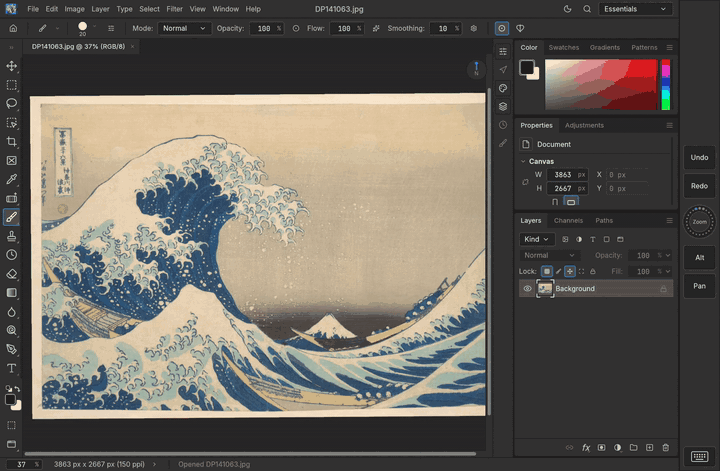
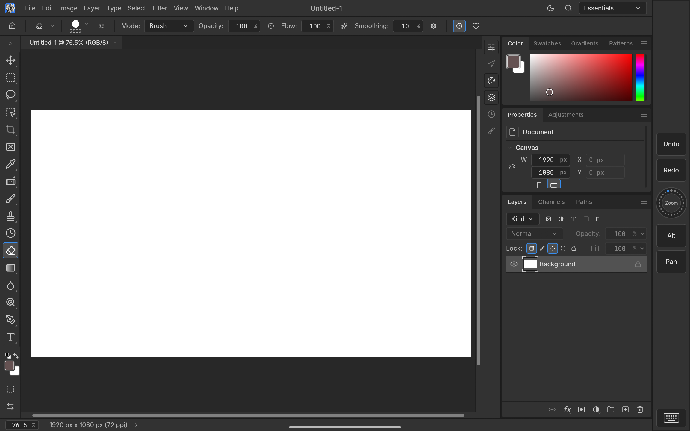
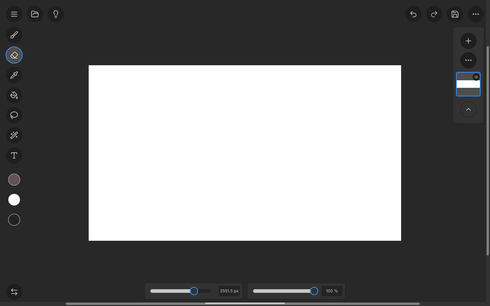

# PhotoCraft for Android
### A desktop-class image editor, rebuilt for Android tablets.

[All releases and release notes](https://github.com/AkSinghSidhu/photocraft-android/releases) · arm64 tablets and phones · a prototype, signed with a debug key for sideloading · Obtainium installs and updates it straight from these releases

| 📱 **Phone layout** | 📷 **Simple Mode on any screen** | 🎨 **All three UI surfaces** |
|---|---|---|
| On narrow windows the panels fold into phone-friendly sheets, so Studio Mode works without a tablet-width screen. Simple Mode's corner buttons and pills compact the same way. | Two UIs in one app, switchable from the View menu or the toolbar: the desktop-like Studio layout, and a touch-first shell — floating menu, tool rail with colour picks, size and opacity pills at the bottom, layers palette on the edge. They live on every screen the app runs on, tablet or phone. | Same document, same tools: switch UI while editing and the canvas keeps its place — nothing is reloaded, nothing is lost. |

| 🎛️ **Shortcut Pad** | ✒️ **Real pen support** | ⌨️ **Keyboards that work** |
|---|---|---|
| ExpressKeys-style touch keys and a spin wheel for zoom, rotate, brush size and undo. Hold Alt while you draw. | Pressure, tilt and the eraser end on Wacom EMR, S Pen and USI pens. | Ctrl, Alt and Shift shortcuts on hardware keyboards, plus an on-screen keyboard key for shortcuts without one. |
| 📂 **Real PSD files** | 🔄 **Updates itself** | 🖥️ **The full engine** |
| Open, edit and save layered PSDs from any folder or app, through Android's file picker or Share. | New builds are offered inside the app. One tap to install. | Same layers, masks, adjustments, brushes and type as the desktop app, running on your tablet's GPU. |
| 🤏 **Multi-touch gestures** | 🖐️ **Palm rejection** | 👆 **Touch-friendly lists** |
| Pinch to zoom, twist to rotate and drag with two fingers to pan, all at once. Two-finger tap undoes, three-finger tap redoes, and each tap can run any shortcut. | Rest your hand on the screen while you draw: fingers are ignored while the pen is on or near it. One finger can draw, move the canvas, or do nothing. | Swipe to scroll menus, brush and layer lists, with momentum. Hold a brush or layer, then drag, to reorder it. |

> [!NOTE]
> Unofficial community port of [PhotoCraft](https://github.com/storytold/photocraft); not made or supported by its developers or ArtCraft.

What the port adds:

- The full PhotoCraft engine and interface on Android (wgpu on Vulkan, OpenGL ES fallback).
- **Pen input:** pressure, tilt and the eraser end of Wacom EMR, S Pen and USI styluses.
- **Files** through Android's document picker (Open, Save, Save As, Open with, Share).
- **Keyboards:** hardware shortcuts with Ctrl/Alt/Shift, and typing on the on-screen keyboard.
- **Touch gestures:** pinch to zoom, twist to rotate, two fingers to pan, two-finger tap to
  undo and three-finger tap to redo, palm rejection, and smooth flick scrolling in menus
  (Window › Touch Input).
- **Shortcut Pad:** 2 to 10 touch keys and a wheel on the screen edge, like a pen tablet's
  ExpressKeys, for working without a keyboard (Window › Shortcut Pad).

Found a bug? [Report it here](https://github.com/AkSinghSidhu/photocraft-android/issues/new/choose).

## Simple Mode (in work, `simple-ui` branch)

A second, touch-first shell in the style of what Clip Studio Paint calls Simple Mode — switchable
at runtime from View › UI Mode, drawn in PhotoCraft's own theme. The Classic desktop UI is
untouched and everything Simple doesn't draw keeps working: the canvas with all gestures and
tools, dialogs, and the Shortcut Pad.

| **Studio Mode — the desktop shell** | **Simple Mode — the touch shell** |
|---|---|
|  |  |

Shipped so far (2026-10-21):

- **Mode switch both ways:** View › UI Mode in the menu bar, a round switch button at the
  bottom-left of Simple Mode, and — on touch devices — the desktop toolbar's Screen Mode slot
  becomes the switch into Simple Mode.
- **A clean touch surface:** round shape tools at the top of the left edge, floating buttons in
  the top corners — menu, open and a tips button on the left; undo, redo, save and a "…"
  quick-actions card on the right (New, Open, Quick Export as PNG, Export As…, Save) — with a
  drawing-colour dot (opens the colour picker), a paper-white dot and a transparent-colour dot
  (swaps to the eraser) under the tools. Double-tapping a tool shows its options.
- **Size and opacity as pill sliders at the bottom centre** (the active tool's, dimmed when
  the tool has no size/opacity; the Fill tool gets its fill opacity).
- **The layers palette at the right edge:** a plus button, a layer action sheet (New Layer,
  Duplicate…, Delete…, an opacity slider), a square-thumbnail stack with the active layer
  ringed, per-layer eye overlay, and a caret that collapses it.
- **The Android Shortcut Pad hides while Simple Mode is on** — the shell owns the screen edge
  there; Studio Mode keeps the pad exactly as before.

To do (next improvement pass):

1. A brush preset picker with previews in the Simple shell (the colour dot and its picker are
   in; presets are not).
2. Layer actions still to add to the sheet: rename and blend mode.
3. Quick actions (New, Open, Export) also on the menu's front page.
4. Always-visible tool settings (not behind a double-tap), with contextual controls for
   selection and Type.
5. 48 dp hit areas for rows in the overlay cards (round buttons are 44 pt; check physical
   scaling on each display).

Details, build steps and what isn't supported yet:
[apps/photocraft-android/README.md](apps/photocraft-android/README.md). The Android work lives on
the `android-port` branch, with Simple Mode on the `simple-ui` branch; `main` mirrors the
original project.

---

## About PhotoCraft

[PhotoCraft](https://github.com/storytold/photocraft) is an open-source image editor written in
Rust by the ArtCraft Team and the PhotoCraft contributors. This fork adds Android support on top
of it; for the official desktop and web app, see the original repository.

## License and credits

Based on PhotoCraft, Copyright (c) 2026 ArtCraft Team and the PhotoCraft contributors, licensed
under the MIT License or the Apache License 2.0, at your option ([LICENSE-MIT](LICENSE-MIT),
[LICENSE-APACHE](LICENSE-APACHE)). The Android port's changes are under the same terms.

Required notices are in [NOTICE](NOTICE); third-party assets and their licenses are listed in
[ATTRIBUTION.md](ATTRIBUTION.md).

The ArtCraft name, wordmark and logos are trademarks of the ArtCraft Team and are not covered by
these licenses ([`docs/brand/LICENSE-brand.txt`](docs/brand/LICENSE-brand.txt)).
