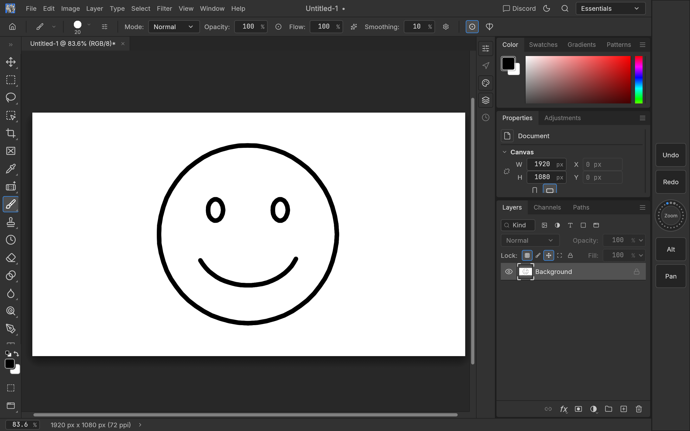
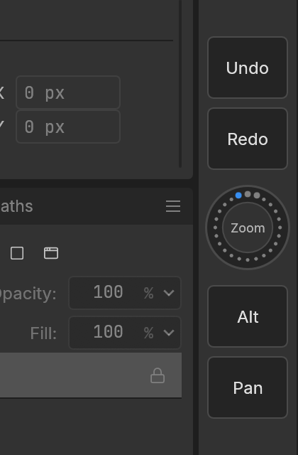

# PhotoCraft for Android tablets (prototype)

The same PhotoCraft app (engine, compositor, brushes, file formats, egui UI) running on Android
tablets: an arm64-v8a APK, minimum Android 8.0 (API 26), built for Android 15 (API 35).

Status: **functional prototype.** It builds, installs and starts; editing, file access and pen
input are wired up. It is not tuned for touch-first use yet (see [Not supported](#not-supported-yet)).

## How it fits together

```text
PhotoCraftActivity.java (extends GameActivity)       libphotocraft_android.so (this crate)
 ├─ dispatchTouchEvent / dispatchGenericMotionEvent ──JNI──▶ photocraft-tablet::android ─▶ StylusFeed
 │    (pressure, AXIS_TILT, AXIS_ORIENTATION, tool type)        (pure mapping: tablet::motion)
 ├─ Storage Access Framework pickers   ◀──files──▶  bridge.rs (request.json / answer.json / sync/)
 ├─ Open with / Share  ──────────────────files──▶  bridge/incoming ─▶ app inbox
 └─ GameActivity ──▶ android-activity ──▶ winit ──▶ eframe (wgpu: Vulkan, GLES fallback)
                                                     └─▶ PhotocraftApp (photocraft-ui-egui, unchanged)
```

- **Rendering:** eframe's native runner on winit's GameActivity backend. wgpu uses Vulkan, or
  OpenGL ES 3 where Vulkan is missing; the GPU canvas is used whenever the adapter is a real GPU.
- **Pen (Wacom EMR, S Pen, USI):** winit forwards only pressure (as touch force). The Activity
  reads every `MotionEvent`'s pressure, tilt, orientation and tool type (including historical
  samples) and passes them to Rust through one JNI method with primitive arguments.
  `photocraft-tablet`'s `motion` module turns Android's polar tilt (angle from the normal plus
  direction) into the W3C `tiltX`/`tiltY` pair the brush engine uses, and flags the eraser end,
  which switches to the Eraser tool as on the desktop. Samples feed the same `StylusFeed` as
  the desktop tablet monitors, so Pen Pressure/Tilt brush dynamics, Preferences › Tools › Use
  Tablet Pressure and the pressure curve all apply.
- **Files:** File › Open and Save As show Android's document pickers. Picked documents are copied
  into app-private storage and opened from there. Saving writes the private copy, then the
  Activity copies it back to the document (when the provider grants write access; otherwise a
  message suggests Save As). Documents sent from other apps ("Open with", "Share") open in a new
  tab. Preferences and brush presets live in the app's private storage.
- **On-screen keyboard:** winit 0.30 opens the soft keyboard but drops GameActivity's text
  events, so the shell (`src/app.rs`, `src/ime.rs`) polls the keyboard's text state each frame
  while a text field has focus and replays the changes as egui text/Backspace/Enter events. The
  keyboard is set to multi-line so its Enter key reaches the app, and it is put away when focus
  leaves the field.
- **Hardware keyboard shortcuts:** winit 0.30 never reports modifier state on Android, so the
  shell (`src/keys.rs`) tracks Ctrl, Alt and Shift from their own key presses, in event order
  (Android often delivers Ctrl down, S down and Ctrl up within one frame), and puts them on
  every key and pointer event: Ctrl+S, Ctrl+Z, Ctrl+Shift+S, Alt-click and the rest work.
- **Leaving:** File › Exit (Ctrl+Q) asks, as on the desktop, about unsaved work, then has the
  Activity finish and end the process once saves have been copied back. winit's event loop can't
  be created twice in one process (a relaunch in the same process closed at once) and
  GameActivity's `onDestroy` would wait forever for the stopped Rust loop. Back doesn't close the
  app (it would skip the unsaved-work prompt).
- **Fingers** paint and click like a mouse (pressure 1): winit reports a finger's contact size as
  touch force, so the app turns off `Stylus::touch_force` and takes pressure from the pen only.
- **GPU limits:** device limits are clamped to what the adapter reports
  (`gpu_canvas::limits_for`), since mobile and software Vulkan drivers fall below wgpu's desktop
  defaults (the emulator's SwiftShader: 16 KiB uniform buffers).
- **The bridge** (`src/bridge.rs`) is plain files in `files/bridge`, so it needs no JNI calls
  from Rust and no `unsafe`; the protocol is documented in that module.

`unsafe`: the workspace forbids it. Two attributes need it here: `#[unsafe(no_mangle)]` on
`android_main` (android-activity looks it up by name, `src/app.rs`) and on the JNI pen hook
(`crates/tablet/src/android.rs`). Neither dereferences a pointer.

## Shortcut Pad

A slim strip on the left or right edge of the window with 2 to 10 keys (4 by default) split
above and below a wheel, modelled on a pen tablet's ExpressKeys and Touch Ring, for working
without a keyboard.





- **Keys** press a shortcut while touched. `Ctrl+Z`, `B` or `Tab` act once; a modifier on its
  own (`Alt`, `Shift`, `Ctrl`) or `Space` is held for as long as the finger stays on the key, so
  the pen can Alt-click (Eyedropper, Clone Stamp source) or pan while a key is held.
  Defaults: Undo, Redo, Alt, Pan (Space). With an odd number of keys the extra one sits above
  the wheel. Keys are 44 points tall where they fit and shrink evenly (to 26 points) on a
  shorter screen, so ten fit any tablet.
- **The wheel**: slide a finger around the ring. Clockwise zooms in (one level per 30°), rotates
  the view (follows the finger), grows the brush (10°), hardens it (15°) or redoes (30°);
  counter-clockwise does the opposite. Tap the centre to switch function; the lights on the ring
  show which one of the chosen functions is active, the centre names it.
- **Window › Shortcut Pad**: Show Shortcut Pad, On the Left / On the Right, and Shortcut Pad
  Settings… (the number of keys; each key's label and shortcut, from presets or typed; which
  functions the wheel's centre cycles through; Restore Defaults). Adding keys fills them with the
  presets no key uses yet; removing takes them from the bottom. Settings are saved in the app's files directory
  (`shortcut-pad.json`).

How it works (`src/pad/`): the pad is an egui side panel drawn before the app, so the app lays
out beside it. egui turns only the first touch into the pointer, so a finger on a key would
have kept the pen from drawing; while the pad is shown, `router.rs` takes over touch-to-pointer
emulation: touches that start on the pad go to the pad (never to the canvas), the first touch
elsewhere drives the pointer, and a window or menu drawn over the pad keeps its touches. Keys
become key events before the modifier tracker (`keys.rs`) runs, so they combine with a
hardware keyboard; wheel steps run app commands (`view.zoomIn`, `view.rotateView`,
`tools.increaseBrushSize`, `edit.undo`, …). The Window menu rows come through a small hook in
`photocraft-ui-egui` (`platform_menu.rs`, `Services::platform_menu`).

## Build

Requirements: Rust (see `rust-version` in the workspace `Cargo.toml`) with
`rustup target add aarch64-linux-android`, `cargo install cargo-ndk`, JDK 17, and an Android SDK
with platform 35, build-tools 35 and NDK r27 or newer.

```bash
export ANDROID_HOME=/path/to/android-sdk
export ANDROID_NDK_HOME=$ANDROID_HOME/ndk/27.3.13750724
apps/photocraft-android/build.sh
adb install -r target/android/photocraft-<version>-arm64-v8a.apk
```

`build.sh` builds the library with `cargo ndk` (copying it into `android/app/src/main/jniLibs`),
then runs Gradle (`android/`, wrapper included). `PROFILE=dev` builds an unoptimised library
faster; `FEATURES=heif` adds HEIC/HEIF decoding. Logs: `adb logcat -s PhotoCraft`.

The release APK is signed with the Android debug key so it installs as is. To distribute it,
add a `signingConfig` with your own keystore in `android/app/build.gradle`.

On a Windows host with the `x86_64-pc-windows-gnu` Rust toolchain: build scripts need a
`dlltool` that works without a GNU assembler (the NDK's `llvm-dlltool.exe`, copied to a folder on
`PATH` as `dlltool.exe`, does), and this crate's host tests can't link (a `cdylib` exceeds the
65,535 DLL export limit of GNU ld); run host tests on Linux, macOS or the MSVC toolchain.

## Tests

```bash
cargo test -p photocraft-android -p photocraft-tablet   # bridge, services, MotionEvent mapping
cargo test -p photocraft-ui-egui --lib stylus           # feed/touch-force precedence
```

The Java side has no unit tests; it was exercised on an emulator:

### Validated on the Android Emulator (2026-10-10)

Android 14 x86_64 Google APIs image, Pixel Tablet profile (2560×1600), running the arm64 APK
through the image's ARM translation; SwiftShader (software Vulkan).

| Check | Result |
|---|---|
| Install, launch, `android_main`, logging to logcat | works |
| Rendering (wgpu on Vulkan; full UI, home screen, panels, canvas) | works |
| Touch: menus, buttons, dialogs | works |
| Soft keyboard: typing into the New Document name, Enter confirms, keyboard hides | works |
| Stylus stroke (`adb shell input stylus swipe`): Java → JNI → `photocraft-tablet` → `StylusFeed` (logcat: `first pen sample`) → brush stroke | works |
| Finger stroke | works (full width, like a mouse) |
| Shortcut Pad: shows on the right, moves left (Window menu), keys (Undo, a preset changed to Eraser), wheel zoom and rotate, centre switches function, settings persist across restarts | works |
| Keyboard shortcuts with modifiers (`adb shell input keycombination`): Ctrl+N opens New Document, Ctrl+Z undoes a stroke, Ctrl+Shift+S opens the save picker | works |
| Ctrl+Q: unsaved-work prompt, then the app closes at once and reopens normally | works |
| File › Save As → system picker → PSD written to the picked document (valid `8BPS` header, 1920×1080 RGB/8) | works |
| File › Open → system picker → that PSD opens in a new tab | works |

Not covered by the emulator: real pressure curves, tilt and the eraser end (adb injects
pressure 1.0 and no tilt; the mapping is unit-tested in `photocraft-tablet`), a hardware GPU
driver, real-device performance, and holding a Shortcut Pad key while the pen draws (adb
injects one touch at a time; the routing is unit-tested in `src/pad/router.rs`).

## Supported

Everything in the shared engine and UI: layers, masks, adjustments, filters, brushes, type,
vectors, history, PSD/PSB, .pcraft, PNG/JPEG/WebP/TIFF/GIF/BMP/EXR/HDR, raw files, Affinity and
OpenRaster import, export settings, preferences, brush presets.

## Not supported yet

| Area | State on Android |
|---|---|
| On-screen keyboard | Typing works (see above), but the keyboard covers the lower half of the screen without resizing the UI; shortcuts with modifiers need a hardware keyboard. Typing on a Type layer on the canvas is untested. |
| Touch gestures | Fingers act as a mouse (egui's touch emulation): no pinch-zoom/two-finger pan of the canvas and no palm rejection (a resting palm can click or paint; the pen's pressure/tilt are unaffected by it). Use the zoom/hand tools. |
| Pen hover | Hover moves are not forwarded by winit 0.30: no brush cursor preview while hovering. The eraser end switches tools on contact, not on proximity, so the first eraser-end touch after flipping still uses the previous tool for that stroke. |
| Barrel rotation | Android has no standard axis for it: rotation stays 0 (Wacom Art Pen rotation is not read). |
| Pen buttons | Barrel buttons are not mapped to shortcuts. |
| UI density | The desktop (Photoshop-like) layout is used unchanged; on small tablets panels are dense. |
| Clipboard images, screen color picker, display ICC profiles | Not available (no Android services wired). |
| Crash-recovery autosave | Not wired; save often. |
| TCP control server / MCP | Not available. |
| Photoshop settings import, system fonts | Not available; bundled fonts only (build with `CRAFT_FONTS_DIR` to add more). |
| Names from document providers | Some providers (Downloads on some devices) report a saved document's name without its extension, or no name. The app keeps the extension it asked for, so the format is right, but the file in that folder may show without `.psd`. |
| Choosing a folder | Commands that ask for a folder (such as loading video frames as layers) report that it isn't supported on Android; pick the files themselves. |
| Saving back to read-only documents | A document whose provider grants no write access is saved to the app's private copy only; a message says to use Save As. |
| Other ABIs | arm64-v8a only (no 32-bit ARM, no x86_64 build target configured). |
